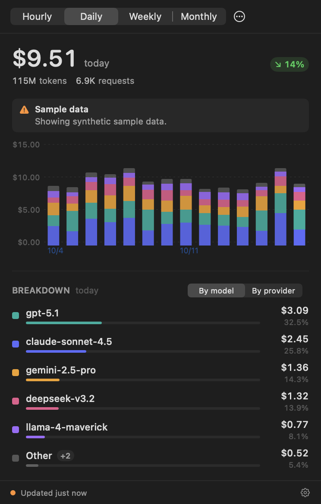

# TokenMeter

A macOS menu bar app that shows what your LLM API usage costs — the current hour,
day, week, or month — and breaks it down by model and provider when the API
exposes that.

Built for OpenRouter today, with a provider interface designed so switching or
adding a vendor is a self-contained change.



Screenshots in `docs/screenshots/` are generated by `make snapshot`, which renders
the real view hierarchy offscreen against the built-in sample provider.

## Install

Requires macOS 14 or later. Building requires Xcode (or at least its toolchain —
see [Development](#development)).

```bash
git clone <this repo> && cd tokenmeter
make bundle      # builds build/TokenMeter.app
make install     # copies it to /Applications
open -a TokenMeter
```

`make bundle` ad-hoc signs the app. For a distributable build:

```bash
CODESIGN_IDENTITY="Developer ID Application: Your Name (TEAMID)" make bundle
```

## Setup

Click the menu bar item, then the ellipsis → **Settings**, and paste a key for
OpenRouter.

### Which key to use

| Key type | What the app can show |
| --- | --- |
| **Management key** ([create one](https://openrouter.ai/settings/management-keys)) | Account-wide spend, hourly through monthly, with per-model and per-provider breakdown, plus credit balance |
| **Inference key** (`sk-or-v1-…`) | This key's own totals for the current day, week, and month. No history, no breakdown, no hourly |

The app detects which one you pasted and adapts: the window picker and the
breakdown control only offer what your credential can actually fill. It never
silently substitutes a different number.

Management keys cannot make inference requests, so this app is strictly
read-only, and the key never leaves your machine except to talk to
`openrouter.ai`.

Want to see the interface before adding a key? Enable **Sample data** in Settings
(or click *Preview with sample data*) for a synthetic provider.

## How spend is computed

- **Menu bar figure** is the in-progress period: this hour, today, this week, this
  month.
- **Chart** shows the trailing history for that window — 24 hours, 14 days, 8
  weeks, or 6 months — as a stacked bar chart.
- **Percent change** compares against the *same elapsed duration* of the previous
  period. Comparing a partial Tuesday against a whole Monday would fabricate a
  large drop every morning.
- **Buckets follow your calendar.** OpenRouter reports UTC days; the app fetches
  hour-level rows and re-buckets into local time, so 11pm spend lands on the
  correct day. Weekly and monthly windows use day-level rows and can shift by a
  few hours at a boundary.
- **Amounts are USD**, summed as `Decimal` rather than `Double` so thousands of
  sub-cent charges do not drift.

## Privacy

- API keys live in the login Keychain, never in a config file.
- Preferences are a plain JSON file at
  `~/Library/Application Support/TokenMeter/settings.json`.
- No telemetry, no analytics, no third-party services. The only network traffic
  is to the provider APIs you configure.

Ad-hoc signed development builds get a new signature on each rebuild, which macOS
treats as a different app for Keychain purposes — the first read after a rebuild
may prompt once. Choose *Always Allow*.

## Development

```bash
make setup      # brew install swiftformat swiftlint
make check      # lint + tests
make run        # build and launch
```

Read [AGENTS.md](AGENTS.md) before contributing; it lists the invariants that keep
the numbers honest. Design rationale is in
[docs/ARCHITECTURE.md](docs/ARCHITECTURE.md), and
[docs/ADDING_A_PROVIDER.md](docs/ADDING_A_PROVIDER.md) walks through the provider
interface.

One environment note: `@State` and friends are macros provided by the **Xcode**
toolchain. If `xcode-select` points at the Command Line Tools, the app target will
not compile. The `Makefile` exports `DEVELOPER_DIR` automatically when
`/Applications/Xcode.app` exists, so build with `make` rather than bare
`swift build`.

## Provider support

| Provider | Status | Notes |
| --- | --- | --- |
| OpenRouter | Supported | Analytics API with management key; `/key` totals otherwise |
| Sample data | Built in | Synthetic, for UI work |
| Anthropic, OpenAI, others | Not yet | See [docs/ADDING_A_PROVIDER.md](docs/ADDING_A_PROVIDER.md) |

## Sources

- [OpenRouter Activity API](https://openrouter.ai/docs/guides/features/activity) — analytics endpoints and management-key requirement
- [Query analytics data](https://openrouter.ai/docs/api/api-reference/analytics/query-analytics-data) — request/response schema for `/api/v1/analytics/query`
- [Get current API key](https://openrouter.ai/docs/api/api-reference/api-keys/get-current-api-key) — the `usage_daily` / `usage_weekly` / `usage_monthly` fields used as the degraded path
- [Control costs with the Analytics API](https://openrouter.ai/docs/cookbook/administration/analytics-cost-control) — metric names (`total_usage`) and the "parse defensively" advice

## License

MIT — see [LICENSE](LICENSE).
