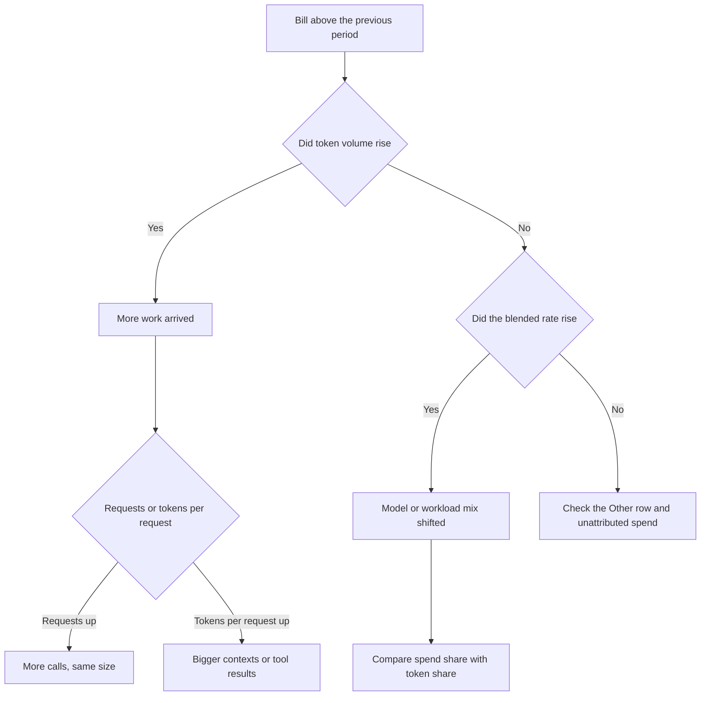

# Reading the numbers

TokenMeter answers "what is this costing" first. The token and request views
answer the follow-up: *what did that money buy, and is the mix where I think it
is?* This page explains what each figure means, when it lies, and which one to
look at for a given question.

All figures come from what the provider reports. The app does not estimate,
extrapolate, or price tokens itself; if a provider returns no token counts, the
token measures and the efficiency block are hidden rather than guessed.

## The three measures

The breakdown, the share bars, and the row ordering can be measured three ways.
Only the ranking and the percentages change; the underlying rows are the same
series you see in the chart.

| Measure | Percentage means | Ranking by | Use it to ask |
| --- | --- | --- | --- |
| Spend | share of the period's spend | money | where is the bill going |
| Tokens | share of the period's tokens | prompt + completion tokens | who is doing the work |
| Requests | share of the period's requests | request count | is the workflow churning |

"Share of the period" means the **in-progress period** — the same denominator as
the headline figure. A row reading `34.2% of tokens` under `$9.50 today` is
34.2% of *today's* tokens, not of the chart's 14 days. That is deliberate: a
share computed over a different interval than the headline would invite
comparing two numbers that describe different populations.

Colours come from the window-wide spend ranking, not list position. A series
keeps its chart colour when the list is re-sorted by tokens.

## Share of tokens versus share of spend

Every row shows both, for the same period:

```
deepseek-v3.2     4.4M tok   47.0% · 13.9% of spend
claude-sonnet-4.5  546K tok    5.9% · 25.8% of spend
```

Read the pair, not either number alone. The difference is a mix signal, not a
verdict:

| Tokens | Spend | Reading |
| --- | --- | --- |
| high | low | cheap workhorse carrying volume — summarisation, extraction, bulk edits |
| low | high | expensive model doing selected work — reasoning, planning, hard debugging |
| high | high | the cost driver on both axes; the first place to look |
| low | low | noise at this granularity; ignore it |

A large positive gap (spend share above token share) does not mean waste. It
means the series is priced above average, which may be exactly why it is there.
The useful question is whether the work it does could move to a cheaper tier
without losing quality — something these numbers cannot answer for you.

## Blended rate

```
                 spend
rate = ─────────────────────── × 1,000,000
         tokens in the window
```

Shown as `$4.68/M`. Two caveats govern its interpretation:

- **It is blended across input and output pricing.** Providers bill completion
  tokens several times higher than prompt tokens, so the blended rate is a
  weighted average that moves with the model's output ratio. Two models with
  identical price lists can show different blended rates purely because one
  answers longer. Compare rates between models with similar ratios, or compare a
  model against its own history.
- **It reflects what was billed, not the list price.** Cached or discounted
  prompt tokens pull the blended rate below the published input price. A rate
  that falls while token volume holds steady usually means caching started
  working, not that the model got cheaper.

Free models report spend of zero, so their rate is zero and their spend share is
zero. They are visible only in the token and request measures.

## Output-to-input ratio

```
ratio = completion tokens / prompt tokens
```

Displayed as `0.26 out : in` — roughly one completion token per four prompt
tokens.

| Range | Typical workload | The lever |
| --- | --- | --- |
| 0.05–0.30 | chat, retrieval, agent loops with long context | prompt size: trimming, caching, fewer tool results |
| 0.30–0.60 | drafting, coding, analysis | output length and model tier |
| 0.60+ | long-form generation from short prompts | completion pricing and `max_tokens` |

Reasoning models that bill internal reasoning as completion tokens raise the
ratio without producing longer visible answers. If a ratio jumps after a model
switch, check whether the new model reports reasoning tokens rather than
assuming the assistant got chattier.

## Tokens and cost per request

```
tokens per request = total tokens / requests
cost per request   = spend / requests
```

Tokens per request is a context-size proxy: rising values mean larger prompts,
more retrieved documents, or more tool-result turns. Cost per request is the
unit-economic figure to use when swapping models for the same job — much more
comparable than a per-million rate, because it already folds in the mix that
workload produces.

Both are averages. The provider reports totals, not distributions, so a handful
of enormous requests and many small ones collapse into the same mean. Retries
and failed calls still count as requests, which deflates tokens per request and
inflates the request count; a workflow that starts retrying looks like it got
cheaper per call.

## The priciest-model line

```
claude-sonnet-4.5 costs the most per token: $4.68/M, 4.2x blended
```

Selection rule: highest blended rate among series holding at least 1% of the
window's tokens, with "Other" excluded. The floor exists because a series with a
few dozen tokens can imply an absurd rate through rounding alone — that is
arithmetic, not a price anyone paid.

The rate multiple is relative to the window's blended rate. Use it to decide
whether the expense is structural (a frontier model doing the hard third of the
work, and worth it) or incidental (a default setting routing bulk jobs to the
expensive model).

## Efficiency covers the window, not the headline

Efficiency figures span the whole displayed range — 24 hours, 14 days, 8 weeks,
or 6 months — and the caption says so. A partial hour rarely holds enough tokens
for a rate or a ratio to be stable, and a value that jumps on every refresh
teaches nothing. This is the one block that intentionally does not share the
headline's denominator.

The window length changes the figure slightly: the hourly view averages 24 hours
of work, so it will not react to a single expensive request the way the
breakdown does. Use the breakdown for "right now", efficiency for "the shape of
the workload".

## What the numbers cannot tell you

- **Whether the money was well spent.** There is no success, quality, or latency
  signal in a cost API. Cheap and useless scores the same as cheap and effective.
- **Cache hit rate.** This would be the strongest efficiency metric available,
  but OpenRouter's analytics endpoint as used here exposes prompt and completion
  totals only, not cached-prompt tokens. Until a cached-token metric is
  discovered and carried through `SpendSlice`, the blended rate is the closest
  proxy.
- **Per-request distributions.** Only averages exist.
- **Prior-period token comparison.** Spend is compared against the equivalent
  elapsed slice of the previous period; tokens are not yet, so the delta badge
  still speaks only about money.
- **What hides in "Other".** If more series exist than the configured limit, the
  remainder is folded. Its spend, tokens, and requests are real and included,
  but attributed to no single model.

## Which lens for which question

| Question | Measure | Then read |
| --- | --- | --- |
| Why is today's bill high? | Spend | token share of the top rows: volume or price |
| Which model is doing the work? | Tokens | spend share to see what that work costs |
| Is my agent looping or retrying? | Requests | tokens per request: small values with many calls |
| Should I switch models? | Spend | cost per request, then the two blended rates |
| Did caching help? | Spend | blended rate against its own earlier value |



The first branch separates volume from price, which is the distinction that
determines whether the fix is a budget conversation or a model-change
conversation.
